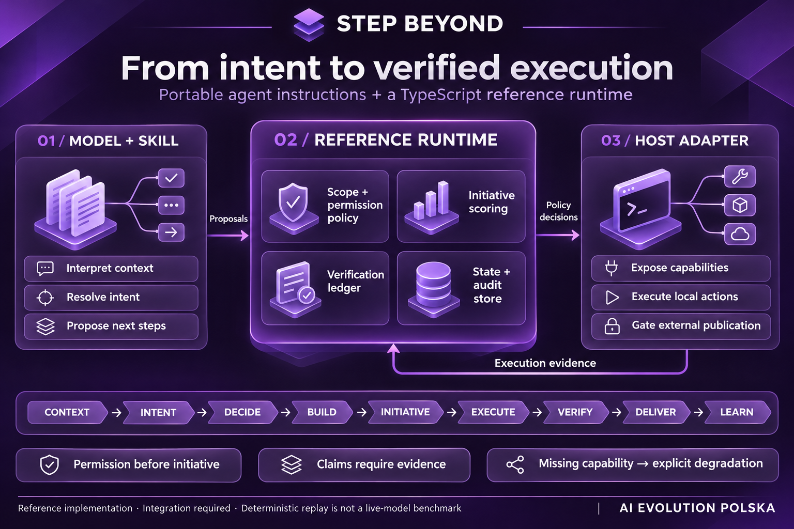
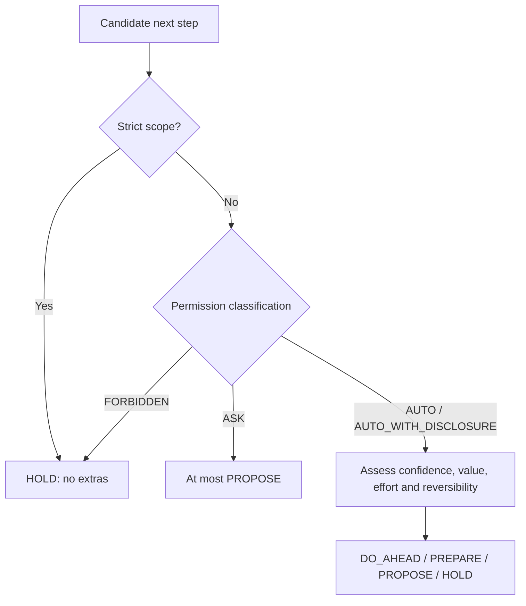

# Step Beyond

## Every task. One step further.

**A portable skill and TypeScript reference runtime for AI agents that understand
the goal, complete the task, and verify their work.**

Step Beyond gives an agent a structured workflow: read the context, resolve
intent, build the requested result, assess useful next steps, and report evidence.
The skill guides the model’s reasoning. When integrated with a host, the runtime
handles permission classification, initiative selection, verification records,
and persistent state.

**The result:** a deliverable with a clear account of what was checked, what remains
uncertain, and which follow-up actions require permission.

**Version 4.0.0-alpha.3** · Hybrid prompt and TypeScript reference implementation

[Polski](README_PL.md) · [ChatGPT edition](README_CHATGPT.md) · [Specification](SPEC.md) · [Runtime API](docs/runtime.md)

[Quick start](#quick-start) · [Architecture](#architecture) · [Example](#example-add-a-contact-form) · [Operating contract](#the-operating-contract) · [Evaluations](evals/README.md)



## Architecture

Step Beyond combines a **portable agent skill** with a **TypeScript reference
runtime**. The model interprets the request and proposes actions. The controller
resolves structured intent hypotheses, classifies permissions before scoring
initiative, and records verification evidence. The host adapter connects these
decisions to execution tools; the store persists scoped state and audit history.

These components require integration with an agent. Missing execution capabilities
limit verification; missing storage rules out durability claims. The
[runtime API examples](docs/runtime.md) describe the concrete integration contracts.

### Choose your integration level

Use the skill to guide an existing agent, or integrate the runtime when you need
explicit policy decisions and auditable state:

| Mode | What you get | What you do not get |
|---|---|---|
| **prompt-only** | Portable reasoning, strict-scope instructions, permission-aware decisions, claim discipline | Enforced persistence, shared state, deterministic permission gates, or audit guarantees |
| **runtime-backed** | The portable layer plus the reference policy controller, store, adapter contract, verification ledger, and eval runner | A claim that every model or host behaves correctly without adapter-specific behavioral evidence |

`verified` is an evidence status, not a marketing label. It applies only to the
adapter, host, model, and behavior covered by repeated recorded measurements.

### Reference packages

| Package | Responsibility |
|---|---|
| `@step-beyond/runtime-core` | Intent decisions, strict scope, permissions, adaptive initiative, verification, learning, and turn control |
| `@step-beyond/runtime-store` | Namespace isolation, secret rejection, atomic JSON state, audit history, correction, deletion, and rollback |
| `@step-beyond/adapter-reference` | Capability detection, explicit degradation, local execution, and publication permission boundaries |
| `@step-beyond/eval-runner` | Fresh adapter instances, comparison arms, repetitions, raw evidence, and cost/token/latency/consent metrics |

The runtime packages have no production dependencies. Development uses
TypeScript, `node:test`, and `tsx`.

## Quick start

Choose the path that matches your goal:

| Goal | Start here |
|---|---|
| Add the workflow to an existing agent | [Install the portable skill](#install-the-portable-skill) |
| Develop or integrate the TypeScript packages | [Run the reference runtime](#run-the-reference-runtime) |
| Use the instructions in ChatGPT | [ChatGPT edition](README_CHATGPT.md) |

### Run the reference runtime

Requirements: Node.js 20 or newer.

```bash
git clone https://github.com/aievolutionpl/step-beyond.git
cd step-beyond
npm ci
npm run validate
```

`npm run validate` runs typechecking, the test suite, and the deterministic
runtime replay. This validates the reference implementation; it does not start
a chatbot, web server, or live-model benchmark.

For example, from a TypeScript module in this workspace:

```ts
import {
  classifyAction,
  detectStrictScope,
} from '@step-beyond/runtime-core';

const scope = detectStrictScope('Fix only the typo, nothing else.');
console.log(scope.active); // true: optional extras are suppressed

const decision = classifyAction({
  kind: 'publish_external',
  withinScope: true,
});
console.log(decision.class); // ASK: intent alone does not authorize publication
```

See [`docs/runtime.md`](docs/runtime.md) for API examples, store operations,
adapter wiring, and degradation behavior.

### Install the portable skill

Run from the cloned repository. Choose one command for your host; `--always-on`
also writes standing instructions, so review the host guide before enabling it.

```bash
scripts/install.sh                 # every supported host found in $HOME
scripts/install.sh --host codex    # claude | codex | hermes | all
scripts/install.sh --always-on     # also write the standing instruction block
```

| Host | Skill location | Always-on instruction |
|---|---|---|
| Claude Code | `~/.claude/skills/step-beyond/` or the plugin | plugin `SessionStart` hook or `CLAUDE.md` block |
| Codex | `~/.agents/skills/step-beyond/` | `AGENTS.md` block |
| Hermes | `~/.hermes/skills/step-beyond/` | `SOUL.md` block |

In Claude Code the repository also installs as a plugin:
`/plugin marketplace add aievolutionpl/step-beyond`. For any other host, copy
[`skills/step-beyond/`](skills/step-beyond/) into its skill directory or inject
[`skills/step-beyond/templates/core-injection.txt`](skills/step-beyond/templates/core-injection.txt)
as standing instructions. Per-host rules are in the
[host guide](skills/step-beyond/references/hosts.md).

Use the dedicated [ChatGPT instructions](README_CHATGPT.md) for Custom GPT,
Project Instructions, or chat-based use. Without a connected runtime, those
instructions remain prompt-only.

## Example: “Add a contact form”

| Moment | What the agent does | What you receive |
|---|---|---|
| Understand | Inspects the existing project and form requirements | A solution that fits the application |
| Build | Implements fields, validation and state handling | A complete form within the agreed scope |
| Assess the next step | Considers tests and deployment; checks authority | Local verification and a separate publication decision |
| Verify | Runs available checks and names gaps | Evidence, such as “validation checked; email delivery untested” |

This illustrates the intended workflow, not a benchmark result. The model proposes actions; effectiveness depends on the host, integration and checks actually performed.

### How does it choose an extra step?



Permission is checked before the value of an idea. A useful suggestion does not grant authority to execute it.

## ⚡ What Your Agent Gains

These names describe user-facing capabilities. They do not replace the canonical
v4 lifecycle in [`SPEC.md`](SPEC.md).

| | Superpower | The instinct it installs |
|---|---|---|
| 🧠 | **RECALL** | Uses relevant, attributable user context without turning guesses into facts |
| 🔎 | **SCAN** | Reads the live project: stack, history, conventions, rules, and current constraints |
| 🔍 | **EXPAND** | Reconstructs the intended outcome instead of following the shortest literal interpretation |
| 🎨 | **POLISH** | Builds a complete professional baseline inside the requested scope |
| ➕ | **EXTEND** | Selects optional actions by value, permission, cost, risk, and verifiability |
| 🔮 | **ANTICIPATE** | Recognizes likely next needs without silently exceeding the user's authority |
| ✅ | **VERIFY** | Connects each material claim to a check and names anything left unverified |
| 📈 | **SELF-IMPROVE** | Learns from observable outcomes through auditable, reversible records |

### One lifecycle, one source of truth

```text
CONTEXT → INTENT → DECIDE → BUILD → INITIATIVE → EXECUTE → VERIFY → DELIVER → LEARN
```

| Capability label | Canonical lifecycle stage |
|---|---|
| RECALL | CONTEXT |
| SCAN | CONTEXT |
| EXPAND | INTENT + DECIDE |
| POLISH | BUILD |
| EXTEND | INITIATIVE + EXECUTE |
| ANTICIPATE | INITIATIVE + DECIDE |
| VERIFY | VERIFY |
| SELF-IMPROVE | LEARN |

`DELIVER` leads with the result and reports only claims supported by the
verification ledger. Internal reasoning may be compressed, but derived skills and
adapters preserve the lifecycle semantics and order.

## The operating contract

### Prompt upgrade and next-move prediction

Most prompts are short because the user does not know what a specialist would
specify. The agent rebuilds the missing brief (goal, audience, deliverable,
quality bar, constraints, done-state) from the conversation, memory, the project,
and expert defaults, and asks at most one question.

Before delivery it predicts the user's likely next requests from stated goals,
open loops, observed request sequences, gaps in the result, and the direction of
the session. Each prediction lands on one rung:

| Rung | When | What happens |
|---|---|---|
| `DO_AHEAD` | Confident, cheap, local, reversible, separable from the requested result | Done now, verified, disclosed in one line with how to drop it |
| `PREPARE` | Likely but large, or it would change the requested result | Staged, not applied |
| `PROPOSE` | Plausible, or the action needs permission | One concrete offer |
| `HOLD` | Weak evidence, strict scope, or the per-turn budget is spent | Nothing |

Hits and misses are recorded from the user's next message and adjust how far the
agent goes next time. See the
[anticipation](skills/step-beyond/references/anticipation.md) and
[prompt upgrade](skills/step-beyond/references/prompt-upgrade.md) references.
The prediction hit rate is unmeasured until the Series E cases in
[`evals/cases.md`](evals/cases.md) are run.

### Intent and strict scope

The agent creates multiple materially distinct intent hypotheses. Confidence and
mistake cost determine whether it proceeds, discloses an assumption, asks one
question, or requests permission.

Phrases such as `only`, `just`, `nothing else`, `tylko`, and `nic więcej`
activate strict scope. Strict scope disables optional actions and unsolicited
proposals. It still permits work required for the requested result to function
and checks required for honest reporting.

### Permission before initiative

| Class | Meaning |
|---|---|
| `AUTO` | Cheap, reversible, local, and within scope |
| `AUTO_WITH_DISCLOSURE` | Reversible local action based on a material assumption |
| `ASK` | Publication, sending, material cost, credentials, security, destructive work, irreversible work, or high-cost ambiguity |
| `FORBIDDEN` | Authority escalation, secret exfiltration, unjustified sensitive-memory persistence, or work outside granted authority |

The runtime classifies permission before it scores initiative. `fast`,
`standard`, and `exploratory` modes change the action threshold. `strict` removes
optional actions and unsolicited proposals. V4 uses this adaptive budget instead
of the fixed v3 `5/3/1` ceiling.

### Memory without guess promotion

The user model distinguishes facts, preferences, constraints, observations,
hypotheses, trajectories, open loops, and negative feedback. Each record carries
provenance, scope, confidence, timestamps, origin, sensitivity, and status.

The reference store:

- keeps project facts outside user memory;
- rejects likely credentials before persistence;
- supports inspection, correction, soft deletion, audit history, and rollback;
- treats silence and unobservable usage as `unknown`;
- isolates user records from global heuristic revisions.

When a host already provides memory, rules, skills, or verification, the adapter
assigns one owner to each record and one verification record to each material
claim. See the [adapter contract](skills/step-beyond/references/adapters.md).

### Verification that scopes the claim

| Status | Meaning |
|---|---|
| `verified` | The stated scope was checked and passed |
| `partially_verified` | Named checks passed; named scope remains unchecked |
| `unverified` | No meaningful execution evidence supports the claim |

An unavailable integration does not erase a useful artifact. The agent narrows
or removes the unsupported claim. The [verification reference](skills/step-beyond/references/verification.md)
defines evidence handling; the [slop index](skills/step-beyond/references/slop.md)
defines observable detection and repair rules for text, code, web, images, and
data visualizations.

## Evaluation and evidence

```bash
npm test
npm run typecheck
npm run eval:runtime
```

`eval:runtime` is a deterministic replay smoke test. It checks runtime policies,
the runner, and assertions. It does not measure live model or host behavior.

A behavioral report must preserve raw transcripts and artifacts, name every
model/prompt/runtime/adapter version, and record repetitions, parameters, tokens,
cost, latency, and consent violations. The release-gate and sample-size rules live
in [`evals/README.md`](evals/README.md). New reports start from
[`evals/results/TEMPLATE.md`](evals/results/TEMPLATE.md), where each case remains
`NOT RUN` until evidence exists.

Historical Markdown reports keep the limitations recorded when their runs took
place. They do not establish current v4 pass rates.

## Repository map

```text
SPEC.md                              normative behavior
skills/step-beyond/                  portable skill and references
skills/step-beyond-chatgpt/          prompt-only ChatGPT adapter
packages/runtime-core/               policy and lifecycle controller
packages/runtime-store/              auditable JSON user-model store
packages/adapter-reference/          reference capability adapter
evals/runner/                         repeatable evaluation harness
evals/cases.md                        behavioral case catalog
evals/results/                        templates and recorded reports
scripts/install.sh                    installer for Claude Code, Codex, Hermes
hooks/hooks.json                      Claude Code plugin SessionStart hook
docs/runtime.md                       runtime API and degradation guide
examples/                              worked v4 traces
```

## Current status

Version 4 remains an alpha reference implementation. The repository includes a
tested TypeScript controller, store, adapter contract, and deterministic eval
harness. Production host adapters and behavioral claims need repeated
adapter-specific runs before they can carry `verified` status.

## License and attribution

**Created with obsessive attention to detail by**

[**AI EVOLUTION POLSKA**](https://www.aievolutionpolska.pl/)

[https://www.aievolutionpolska.pl/](https://www.aievolutionpolska.pl/) · [https://aievolutionlabs.io/](https://aievolutionlabs.io/)

MIT License — Use it. Remix it. Ship it. Just don't remove the attribution.
