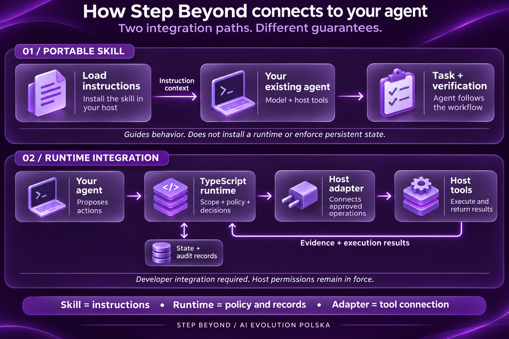
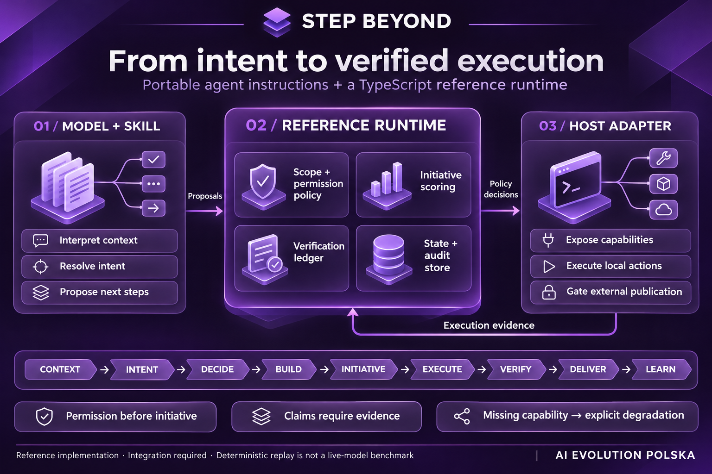

<p align="center">
  
</p>

# Step Beyond

## Każde zadanie. Jeden krok dalej.

**Agent AI, który robi w Twojej pracy jeden użyteczny krok dalej — korzystając
z Twoich celów, kontekstu projektu i doświadczeń ze współpracy z Tobą.**

Step Beyond pomaga agentowi dostrzec, czego zadanie potrzebuje poza samą treścią
polecenia. Korzysta z dostępnej wiedzy, kontekstu projektu, Twoich zadeklarowanych
preferencji i obserwowalnych wyników wcześniejszej pracy, aby domknąć brakujące
elementy i przewidzieć przydatny następny krok. Może to oznaczać wychwycenie
pominiętego przypadku, przygotowanie materiału do kolejnego etapu albo sprawdzenie
rezultatu przed oddaniem go Tobie.

Gdy agent ma dostęp do Twoich uwag i wcześniejszych decyzji, może trafniej oceniać,
co Ci pomaga, jaki sposób pracy preferujesz i kiedy należy się zatrzymać.
Działa dodatkowo wtedy, gdy ma to sens, mieści się w zakresie i jest dozwolone;
w pozostałych przypadkach przygotowuje lub proponuje następny krok. Polecenie
„tylko to” skupia pracę na zamówionym rezultacie.

**Cel: pełniej wykonana praca, mniej zbędnych dopowiedzeń i inicjatywa dopasowana
do Twojego sposobu działania.** Przy wyniku agent wskazuje, co sprawdził i czego
jeszcze nie udało się potwierdzić.

Projekt łączy przenośny skill z referencyjnym runtime w TypeScript. Uczenie między
sesjami zależy od historii lub pamięci udostępnianej przez hosta i skonfigurowanej
integracji. Agent korzysta z obserwowalnego feedbacku; nie traktuje ciszy jako
zgody ani przypuszczeń jako ustalonych preferencji.

**Wersja 4.0.0-alpha.3** · Hybrydowa implementacja referencyjna: prompt + TypeScript

[English](README.md) · [Wersja ChatGPT](README_CHATGPT.md) · [Specyfikacja](SPEC.md) · [API runtime](docs/runtime.md)

[Start](#szybki-start) · [Architektura](#architektura) · [Przykład](#przykład-dodaj-formularz-kontaktowy) · [Reguły działania](#kontrakt-działania) · [Ewaluacja](evals/README.md)

## Szybki start

Wymagany jest Node.js 20 lub nowszy.

```bash
git clone https://github.com/aievolutionpl/step-beyond.git
cd step-beyond
npm ci
npm run validate
```

`npm run validate` uruchamia typecheck, testy i deterministyczny replay runtime.

```ts
import {
  classifyAction,
  detectStrictScope,
  resolveIntent,
  selectInitiatives,
} from '@step-beyond/runtime-core';
```

Przykłady API, obsługa store i zasady degradacji są w
[`docs/runtime.md`](docs/runtime.md).

### Przenośny skill

```bash
scripts/install.sh                 # każdy obsługiwany host znaleziony w $HOME
scripts/install.sh --host codex    # claude | codex | hermes | all
scripts/install.sh --always-on     # dopisuje też blok stałych instrukcji
```

| Host | Lokalizacja skilla | Stała instrukcja |
|---|---|---|
| Claude Code | `~/.claude/skills/step-beyond/` albo plugin | hook `SessionStart` pluginu albo blok w `CLAUDE.md` |
| Codex | `~/.agents/skills/step-beyond/` | blok w `AGENTS.md` |
| Hermes | `~/.hermes/skills/step-beyond/` | blok w `SOUL.md` |

W Claude Code repozytorium instaluje się też jako plugin:
`/plugin marketplace add aievolutionpl/step-beyond`. W innym hoście skopiuj
[`skills/step-beyond/`](skills/step-beyond/) do katalogu skilli albo wstrzyknij
[`skills/step-beyond/templates/core-injection.txt`](skills/step-beyond/templates/core-injection.txt)
jako stałe instrukcje. Zasady dla poszczególnych hostów opisuje
[przewodnik po hostach](skills/step-beyond/references/hosts.md).

Dla Custom GPT, Project Instructions i zwykłego czatu użyj
[wersji ChatGPT](README_CHATGPT.md). Bez połączonego runtime działa ona w trybie
prompt-only.

## Jak połączyć Step Beyond z agentem

Najprostsza integracja polega na załadowaniu skilla do hosta agenta. Agent
otrzymuje instrukcje pracy i korzysta ze swoich dotychczasowych narzędzi.
Instalator skilla nie podłącza automatycznie bibliotek runtime.



| Element | Co podłączasz | Za co odpowiada host |
|---|---|---|
| Skill | Instrukcje i potrzebne materiały referencyjne | Załadowanie kontekstu, model i narzędzia |
| Runtime | Wywołania polityk, dane intencji i kandydatów działań | Przekazanie danych i respektowanie decyzji |
| Adapter | Funkcje wykonania oraz wykrywanie możliwości | Faktyczne operacje i uprawnienia |
| Store i weryfikacja | Rekordy stanu, kontrole i dowody | Miejsce zapisu oraz wyniki rzeczywiście wykonanych kontroli |

Przy integracji runtime aplikacja przekazuje propozycje do kontrolera, obsługuje
wynik decyzji, wywołuje dozwolone operacje przez adapter i zapisuje zwrócone
dowody. Samo zainstalowanie zależności nie tworzy tego połączenia. Szczegóły:
[API runtime](docs/runtime.md) i [przewodnik po hostach](skills/step-beyond/references/hosts.md).

## Przykład: „Dodaj formularz kontaktowy”

| Moment | Co robi agent | Co otrzymujesz |
|---|---|---|
| Rozumie | Sprawdza istniejący projekt i wymagania formularza | Rozwiązanie dopasowane do aplikacji |
| Buduje | Przygotowuje pola, walidację i obsługę stanów | Kompletny formularz w uzgodnionym zakresie |
| Ocenia następny krok | Rozważa testy i wdrożenie; sprawdza uprawnienia | Lokalną weryfikację i osobną decyzję o publikacji |
| Weryfikuje | Uruchamia dostępne kontrole i wskazuje braki | Wynik z dowodami, np. „walidacja sprawdzona; wysyłka e-mail nieprzetestowana” |

To przykład zamierzonego sposobu pracy, a nie wynik benchmarku. [Polska infografika](docs/assets/step-beyond-explained-pl.png) pokazuje ten sam przykład krok po kroku. Model proponuje działania; skuteczność zależy od hosta, integracji i wykonanych kontroli.

## ⚡ Co zyskuje Twój agent

Poniższe nazwy opisują możliwości widoczne dla użytkownika. Nie zastępują
kanonicznego lifecycle z [`SPEC.md`](SPEC.md).

| | Superpower | Instynkt, który otrzymuje agent |
|---|---|---|
| 🧠 | **RECALL** | Korzysta z istotnego kontekstu użytkownika wraz ze źródłem, bez zamiany przypuszczeń w fakty |
| 🔎 | **SCAN** | Czyta aktualny projekt: stack, historię, konwencje, reguły i ograniczenia |
| 🔍 | **EXPAND** | Odtwarza oczekiwany rezultat zamiast wybierać najkrótszą literalną interpretację |
| 🎨 | **POLISH** | Buduje kompletną, profesjonalną bazę w ramach zleconego zakresu |
| ➕ | **EXTEND** | Wybiera działania opcjonalne według wartości, zgody, kosztu, ryzyka i możliwości weryfikacji |
| 🔮 | **ANTICIPATE** | Rozpoznaje prawdopodobny następny krok bez samowolnego rozszerzania uprawnień |
| ✅ | **VERIFY** | Łączy każde istotne twierdzenie z kontrolą i nazywa zakres bez weryfikacji |
| 📈 | **SELF-IMPROVE** | Uczy się z obserwowalnych wyników przez audytowalne i odwracalne rekordy |

### Jeden lifecycle, jedno źródło prawdy

```text
CONTEXT → INTENT → DECIDE → BUILD → INITIATIVE → EXECUTE → VERIFY → DELIVER → LEARN
```

| Nazwa możliwości | Etap lifecycle |
|---|---|
| RECALL | CONTEXT |
| SCAN | CONTEXT |
| EXPAND | INTENT + DECIDE |
| POLISH | BUILD |
| EXTEND | INITIATIVE + EXECUTE |
| ANTICIPATE | INITIATIVE + DECIDE |
| VERIFY | VERIFY |
| SELF-IMPROVE | LEARN |

`DELIVER` prowadzi od rezultatu i raportuje wyłącznie twierdzenia obsługiwane
przez ledger weryfikacji. Adapter może skrócić wewnętrzne rozumowanie, lecz
zachowuje znaczenie i kolejność etapów.

## Architektura



Step Beyond łączy **skill z instrukcjami dla agenta** i **referencyjny runtime
w TypeScript**. Model interpretuje polecenie i proponuje działania. Kontroler
rozstrzyga ustrukturyzowane hipotezy intencji, klasyfikuje zgody przed oceną
inicjatywy i zapisuje dowody weryfikacji. Adapter łączy te decyzje z narzędziami
hosta, a store przechowuje stan i historię zmian.

Komponenty wymagają integracji z agentem. Brak możliwości wykonania ogranicza
weryfikację, a brak magazynu stanu wyklucza deklarowanie trwałej pamięci.
[Przykłady API](docs/runtime.md) pokazują konkretne kontrakty tej integracji.

Framework ma dwa jawne tryby:

| Tryb | Co zapewnia | Czego nie gwarantuje |
|---|---|---|
| **prompt-only** | Przenośne rozumowanie, ścisły zakres, decyzje uwzględniające zgody i dyscyplinę twierdzeń | Egzekwowanej trwałości, wspólnego stanu, deterministycznych bramek zgód ani audytu |
| **runtime-backed** | Warstwę promptową oraz kontroler polityk, store, kontrakt adaptera, ledger weryfikacji i runner evali | Poprawnego zachowania każdego modelu i hosta bez powtarzanych testów konkretnego adaptera |

`verified` jest statusem dowodowym. Dotyczy wyłącznie adaptera, hosta, modelu i
zachowania objętego powtarzanymi pomiarami.

### Pakiety referencyjne

| Pakiet | Odpowiedzialność |
|---|---|
| `@step-beyond/runtime-core` | Intencja, ścisły zakres, zgody, adaptacyjna inicjatywa, weryfikacja, uczenie i kontrola tury |
| `@step-beyond/runtime-store` | Izolacja namespace, odrzucanie sekretów, atomowy stan JSON, audyt, korekta, usuwanie i rollback |
| `@step-beyond/adapter-reference` | Wykrywanie możliwości, jawna degradacja oraz granica między wykonaniem lokalnym i publikacją |
| `@step-beyond/eval-runner` | Świeże instancje adaptera, ramiona porównawcze, powtórzenia, surowe dowody i metryki |

Pakiety runtime nie mają zależności produkcyjnych. Projekt korzysta z TypeScript,
`node:test` i `tsx` podczas rozwoju.

## Kontrakt działania

### Ulepszanie promptu i przewidywanie kolejnego ruchu

Większość promptów jest krótka, bo użytkownik nie wie, co doprecyzowałby
specjalista. Agent sam odtwarza brakujący brief (cel, odbiorca, forma, poziom
jakości, ograniczenia, kryterium ukończenia) z rozmowy, pamięci, projektu
i eksperckich ustawień domyślnych. Zadaje najwyżej jedno pytanie.

Przed oddaniem wyniku przewiduje, o co użytkownik poprosi za chwilę: na podstawie
wypowiedzianych celów, otwartych wątków, zaobserwowanych sekwencji próśb, braków
w wyniku i kierunku sesji. Każda prognoza trafia na jeden szczebel:

| Szczebel | Kiedy | Co się dzieje |
|---|---|---|
| `DO_AHEAD` | Pewne, tanie, lokalne, odwracalne i oddzielne od zamówionego wyniku | Zrobione od razu, zweryfikowane, ujawnione jedną linią z informacją, jak to usunąć |
| `PREPARE` | Prawdopodobne, ale duże albo zmieniające zamówiony wynik | Przygotowane, niezastosowane |
| `PROPOSE` | Możliwe albo wymagające zgody | Jedna konkretna propozycja |
| `HOLD` | Słabe przesłanki, ścisły zakres albo wyczerpany budżet tury | Nic |

Trafienia i pudła są zapisywane na podstawie następnej wiadomości użytkownika
i zmieniają to, jak daleko agent idzie następnym razem. Szczegóły:
[anticipation](skills/step-beyond/references/anticipation.md) oraz
[prompt upgrade](skills/step-beyond/references/prompt-upgrade.md). Skuteczność
prognoz pozostaje niezmierzona do czasu uruchomienia przypadków serii E
z [`evals/cases.md`](evals/cases.md).

### Intencja i ścisły zakres

Agent tworzy kilka istotnie różnych hipotez intencji. Pewność oraz koszt pomyłki
decydują, czy agent działa, ujawnia założenie, zadaje jedno pytanie albo prosi o
zgodę.

Zwroty `tylko`, `nic więcej`, `only`, `just` i `nothing else` aktywują ścisły
zakres. Wyłączają działania opcjonalne i nieproszone propozycje. Nie wyłączają
pracy wymaganej do poprawnego działania zamówionego rezultatu ani kontroli
potrzebnych do uczciwego raportu.

### Zgoda przed inicjatywą

| Klasa | Znaczenie |
|---|---|
| `AUTO` | Tanie, odwracalne, lokalne i zgodne z zakresem |
| `AUTO_WITH_DISCLOSURE` | Odwracalne działanie lokalne oparte na istotnym założeniu |
| `ASK` | Publikacja, wysyłka, koszt, dane dostępowe, bezpieczeństwo, destrukcja, nieodwracalność lub kosztowna niejednoznaczność |
| `FORBIDDEN` | Eskalacja uprawnień, wyciek sekretów, nieuzasadniony zapis danych wrażliwych lub działanie poza udzieloną władzą |

Runtime klasyfikuje zgodę przed scoringiem inicjatywy. Tryby `fast`, `standard`
i `exploratory` zmieniają próg. `strict` usuwa działania opcjonalne i nieproszone
propozycje. V4 używa tego adaptacyjnego budżetu zamiast stałego limitu v3 `5/3/1`.

### Pamięć bez promowania domysłów

Model użytkownika rozróżnia fakty, preferencje, ograniczenia, obserwacje, hipotezy,
trajektorie, otwarte pętle i negatywny feedback. Rekordy zawierają źródło, zakres,
pewność, znaczniki czasu, pochodzenie, wrażliwość i status.

Referencyjny store:

- trzyma fakty projektowe poza pamięcią użytkownika;
- odrzuca prawdopodobne dane dostępowe przed zapisem;
- obsługuje inspekcję, korektę, miękkie usuwanie, audyt i rollback;
- traktuje ciszę i nieobserwowalne użycie jako `unknown`;
- izoluje rekordy użytkownika od globalnych zmian heurystyk.

Gdy host ma własną pamięć, reguły, skille lub weryfikację, adapter wybiera jednego
właściciela rekordu i jeden rekord weryfikacji dla każdego istotnego twierdzenia.
Szczegóły opisuje [kontrakt adaptera](skills/step-beyond/references/adapters.md).

### Weryfikacja o dokładnym zakresie

| Status | Znaczenie |
|---|---|
| `verified` | Zadeklarowany zakres sprawdzono i przeszedł kontrolę |
| `partially_verified` | Nazwane kontrole przeszły, lecz nazwany zakres pozostał bez sprawdzenia |
| `unverified` | Brak istotnego dowodu z wykonania |

Niedostępna integracja nie usuwa użytecznego artefaktu. Agent zawęża albo usuwa
niepoparte twierdzenie. [Zasady weryfikacji](skills/step-beyond/references/verification.md)
opisują dowody, a [slop index](skills/step-beyond/references/slop.md) zawiera
obserwowalne reguły wykrywania i naprawy tekstu, kodu, stron, obrazów i wykresów.

## Ewaluacja i dowody

```bash
npm test
npm run typecheck
npm run eval:runtime
```

`eval:runtime` jest deterministycznym smoke testem replay. Sprawdza polityki,
runner i asercje. Nie mierzy zachowania żywego modelu ani hosta.

Raport behawioralny musi zachować surowe transkrypty i artefakty, podać wersje
modelu, promptu, runtime i adaptera oraz zapisać powtórzenia, parametry, tokeny,
koszt, opóźnienie i naruszenia zgód. Reguły release gate oraz próby opisuje
[`evals/README.md`](evals/README.md). Nowy raport zaczyna się od
[`evals/results/TEMPLATE.md`](evals/results/TEMPLATE.md), gdzie case pozostaje
`NOT RUN`, dopóki nie istnieje dowód.

Historyczne raporty Markdown zachowują ograniczenia zapisane podczas swoich
uruchomień. Nie ustalają aktualnego pass rate v4.

## Status

Wersja 4 pozostaje implementacją referencyjną w fazie alpha. Repo zawiera
przetestowany kontroler TypeScript, store, kontrakt adaptera i deterministyczny
harness eval. Produkcyjne adaptery hostów i twierdzenia behawioralne wymagają
powtarzanych testów konkretnego adaptera przed statusem `verified`.

## Licencja i autorstwo

**Created with obsessive attention to detail by**

[**AI EVOLUTION POLSKA**](https://www.aievolutionpolska.pl/)

[https://www.aievolutionpolska.pl/](https://www.aievolutionpolska.pl/) · [https://aievolutionlabs.io/](https://aievolutionlabs.io/)

MIT License — Use it. Remix it. Ship it. Just don't remove the attribution.
